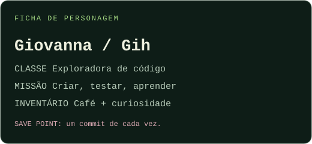
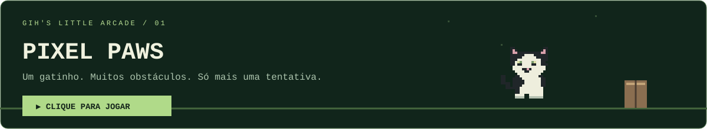

<p align="center">
  
</p>

<p align="center">
  <a href="#-player-01">PLAYER 01</a> ·
  <a href="#-inventário">INVENTÁRIO</a> ·
  <a href="#-missões">MISSÕES</a> ·
  <a href="https://gihmartinsdev.github.io/gihmartinsdev/">JOGAR PIXEL PAWS ↗</a>
</p>


Oi, eu sou a **Giovanna**, mas pode me chamar de **Gih**.

Este é o meu cantinho de código: um pouco de lógica, um pouco de criatividade e um gatinho sempre por perto. Gosto de transformar ideias em projetos e descobrir coisas novas pelo caminho. **Uma fase — e um commit — de cada vez.**

<p align="center">
  
  
</p>


## 🎒 Inventário

Ferramentas que estão passando pelas minhas aventuras:

<p>
  
  
  
  
</p>

```text
gih.inventory
├── criatividade         → ideias esperando para sair do papel
├── curiosidade          → modo exploração sempre ligado
├── persistência         → tentar, ajustar e tentar de novo
└── companheiro felino   → suporte emocional + inspeção do teclado
```


## 🕹️ Uma pausa para jogar?

<a href="https://gihmartinsdev.github.io/gihmartinsdev/">
  
</a>

**Espaço, seta para cima, clique ou toque para pular.** O jogo abre em uma página própria. Seu recorde fica salvo no navegador.

## 🐍 Trilha de contribuições


<details>
  <summary>🎁 Encontrou uma passagem secreta? Clique aqui.</summary>

  <br />

  **Item encontrado: biscoito de coragem 🍪**

  Se o código não funcionou de primeira, você não perdeu a fase. Só encontrou mais uma pista.

  Obrigada pela visita! Deixe uma estrelinha em um projeto de que você gostou. 🌟

</details>

<p align="center"><br /><a href="https://github.com/gihmartinsdev">↗ Vamos criar alguma coisa?</a><br /><sub>made of pixels, curiosity &amp; cat hair.</sub></p>
